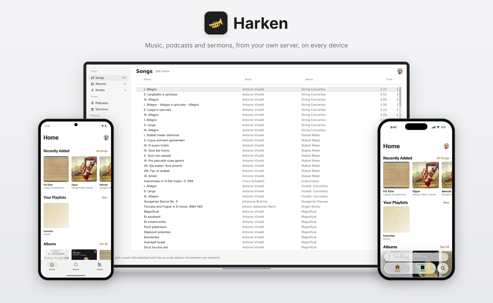
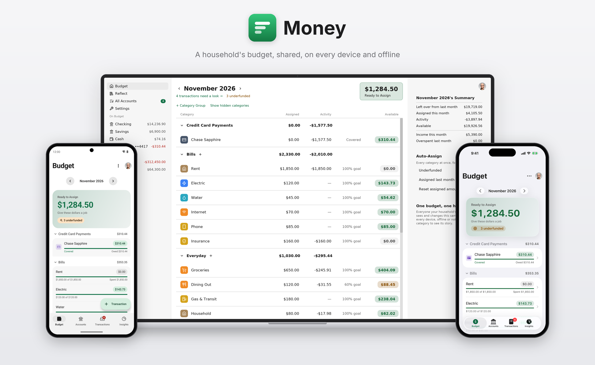

# apps

ArkDB — a local-first sync engine with one runtime, Rust, whose domain is
a crate of plain Rust every peer links — and harken, the first app on it.

## harken

<picture>
  <source media="(prefers-color-scheme: dark)" srcset="https://raw.githubusercontent.com/k2on/apps/screens/apps/harken/hero-dark.png">
  <source media="(prefers-color-scheme: light)" srcset="https://raw.githubusercontent.com/k2on/apps/screens/apps/harken/hero-light.png">
  
</picture>

## The repository

- `rust/ark` — the kernel and the specification (`spec/README.md`
  indexes its modules): the value format (postcard by default, JSON as a
  feature; JSON is the human form) and memcomparable keys, the schema and
  the store, the chained log, the one sans-io peer machine (replica or
  authority; alone is an authority), the frames, a domain in plain Rust
  (derives, a `Domain` of functions by name, the typed `Db`) and views
  maintained per operator. `ark-macros` holds its derives and attributes.
- `rust/ark-peer` — the one peer over one disk: a device that dials
  (storage, the link with redial, the app kit a UI calls by name, the live
  relay) and a server that listens (the connections, the log written
  before delivered, the sync socket, the web build).
- `rust/ark-ffi` — `ark-peer`'s app kit through UniFFI for an app in
  another language; `arkdb gen kotlin|swift` writes a domain's types
  and stubs for it. The phones run the Rust kernel; there is no Kotlin or
  Swift runtime.
- `rust/arkdb` — the demo, the simulator over real peers in both roles,
  the trace recorder and player, the fuzzer (`arkdb fuzz`), the vector
  writer, `gen`. Beside it `ark-auth` (dev sign-in and OpenID Connect).
- `spec/` — the vectors the kernel is held to (the bytes, the machine, the
  frames, the views), `RUNNERS.md` (how `arkdb` runs them) and
  `AUTHORING.md` (writing a domain).
- `harken/` — the app: `domain/` (a crate of plain Rust), `server/` and
  `iced/` (desktop and browser), and the phones: `ffi/` (the kernel with
  the domain linked in, one native library) under `android/` (Compose)
  and `ios/` (SwiftUI), each over the types `arkdb gen` writes.
  `harken/README.md` says how to run them together.
- `docs/site` — the documentation site, static HTML generated with pictures
  drawn by arkui itself, its own Cargo workspace so that it
  and the apps never rebuild each other: arkui's components by component,
  each for the desktop and both phones (https://k2on.github.io/apps/docs/).
- `ui/` — ArkUI, everything an app is drawn with (`ui/README.md` says
  what is where): the theme (`ui/theme.toml`), the iced components
  (`ui/rust/arkui`), ArkUI for SwiftUI (`ui/swift`) and for Compose
  (`ui/kotlin`), the runtime that runs an app's screens in Rust
  (`ui/rust/app`, `ui/docs/app.md`) and the generator that writes them
  for the phones (`ui/rust/gen`), the generator of every Ark app's native
  projects from its `app.toml` (`ui/prebuild.py`, `nix/ark-app.nix`:
  nothing native of an Ark app is committed, `nix run .#<app>-prebuild`
  writes it for Xcode and Android Studio), and the standing rule for
  motion (`ui/docs/motion.md`).
- `modules/` — what an app asks of the device, one package each
  (`modules/ark-haptics`, `clipboard`, `share`, `camera`, `media-player`,
  `notifications`, `secure-store`): a crate with the trait and its fake,
  its Swift and Kotlin implementations, and a README of its permissions.
- `showcase/` — the shared components on their own, an app per phone, which
  the docs' captures are taken from (`.github/workflows/screens.yaml`).
- `docs/plan-v5.md` — the design, how it landed and what it measures
  (Part 3); `docs/arkdb.md` is the history it superseded.

## money

<picture>
  <source media="(prefers-color-scheme: dark)" srcset="https://raw.githubusercontent.com/k2on/apps/screens/apps/money/hero-dark.png">
  <source media="(prefers-color-scheme: light)" srcset="https://raw.githubusercontent.com/k2on/apps/screens/apps/money/hero-light.png">
  
</picture>

`money/` is a second app on ArkDB: a household's budget, YNAB's way —
`domain/` (accounts, categories, the month, transactions, and the Plaid
import ArkOS's `money-sync` did for Actual Budget, as a mutator) and
`iced/`, a demo client on a seeded household with no server. Everyone a
server's OpenID provider lets in shares one budget. `money/README.md`
says what is built and what is not.

## The rest

Each app's demo data is beside its code, not in it: money's core's `demo`
feature (`money/core`), harken's `harken/demo` crate. The demos and tests
link it, and its binary (`money-seed`, `harken-seed`) seeds a server's data directory
for the screenshots or for `nix run .#<app>-demo`. `docs/seed.md` says
what each holds and the contract they share.

`revelation/` is another app, and not on ArkDB: an Android app in plain
Kotlin, no Rust and no native library, that is the Bible as one scroll
zoomed like a map. `revelation/README.md` says how to build and run it and
`docs/plan-bible.md` is its plan. Both apps' APKs are published through one
F-Droid repository.

One command holds all of it:

    nix flake check   # rust: every test of the workspace
                      #   (and harken-iced's demo feature);
                      # clippy: the workspace lint-clean, -D warnings;
                      # fmt: the workspace formatted;
                      # vectors: spec/vectors is what the writer writes;
                      # traces: a fuzzed corpus replays (spec/vectors/trace/ is rust's);
                      # fuzz-smoke: 25 fuzzed sessions;
                      # versions: harken/server/tests/versions.rs over the
                      #   pinned revisions (none pinned now);
                      # harken-domain: the domain builds, its schema hash pinned;
                      # harken-module: the NixOS module evaluates;
                      # ffi: ark-ffi and harken/ffi, their tests, UniFFI's
                      #   Kotlin and Swift, the generated types held to the domain;
                      # harken-ios-typecheck: the iOS app's non-UI Swift
                      #   type-checked on Linux against the library
    nix build .#harken-server   # or harken-iced, harken-domain,
                                # ark, vectors, trace-corpus
    nix run .#money-iced        # money's desktop window
    nix build .#harken-apk      # the kernel for three ABIs and the APK over it,
                                # its JVM tests run on the real kernel
    nix build .#revelation-apk  # Revelation's APK, its JVM tests run first;
                                # *-android-screens are either app's screens
    nix build .#fdroid-repo     # both APKs as the F-Droid repository, signed
                                # and checked; apps-fdroid is what CI runs
    nix run .#fuzz -- 1000 1 traces
    nix run .#update-cargo-nix  # after a Cargo.toml or lockfile edit: the
                                # crates every Rust build is made of
                                # (rust/Cargo.nix, docs/site/Cargo.nix)

What is verified: the kernel, the peer, harken's domain and server by
their tests and the vectors; the fuzzer's sessions converge and every
trace replays; the phone library's surface in-process; the APK builds and
its JVM tests pass over the kernel. What is not: no desktop window has
been opened, the browser build has not been drawn on v5, the APK has not
been installed on a phone, and the iOS app has not been built (it needs a
Mac; its Swift is type-checked only). Each app's `README.md` says where
the seen part ends.

## The desktop window and the GPU

`nix run .#money-iced` (and `harken-iced`) says on stderr, first thing,
what it will draw with: `renderer: wgpu (Vulkan, Apple M2 (G14G), integrated
GPU)`, or `renderer: tiny-skia (CPU) — no GPU adapter: <why>`, the why being
what refused iced's device or which driver library would not load and what
the dynamic loader said. Settings says the same under "Display". iced
otherwise falls back to the CPU without a word (`ui/rust/arkui/src/renderer.rs`).
`ARK_RENDERER=cpu` draws on the CPU; `ARK_RENDERER=gpu` refuses to, and the
window does not open without a device.

What is automatic and what is not:

- **NixOS, any GPU Mesa or NVIDIA drives, Asahi's on Apple silicon
  included: automatic.** The launcher (`nix/gpu-env.sh`, run at each start,
  and sourced by the dev shells) puts the host's own libwayland and X
  libraries — the ones `/run/opengl-driver`'s driver was linked against,
  asked of the driver with `ldd` — and then `/run/opengl-driver/lib` ahead
  of the flake's libraries. The flake's loaders find the drivers in
  `/run/opengl-driver/share` themselves. Before, the flake's older wayland
  shadowed the host's, every Mesa driver failed to load (`undefined symbol:
  wl_fixes_interface`), and the window drew on the CPU. On Asahi wgpu tries
  Vulkan (Honeykrisp, `asahi_icd`) and, if that will not give iced its
  device, GL through EGL on the same GPU, before the CPU.
- **Another distribution: not automatic.** The flake's loaders find the
  host's driver manifests (`/usr/share/vulkan/icd.d`, `/etc/vulkan/icd.d`,
  glvnd's `egl_vendor.d`), but the drivers they name are built against the
  host's C library and libraries, which a program from nixpkgs generally
  cannot load, so expect `tiny-skia` and the loader's reason. Run it under
  [nixGL](https://github.com/nix-community/nixGL), which supplies a Mesa (or
  NVIDIA) userspace from nixpkgs:

      nix run --impure github:nix-community/nixGL -- nix run .#money-iced
      # Vulkan only, Intel or AMD:
      nix run --impure github:nix-community/nixGL#nixVulkanIntel -- nix run .#money-iced
